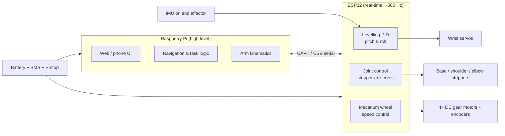

# PID-Robot-Waiter

A Raspberry Pi–controlled robot waiter: an omnidirectional mecanum base, a support mast,
and a 5-DOF robotic arm whose wrist uses IMU feedback and PID control to keep a plate level
while the robot moves.

> **Status:** planning / early build (Nov 2026 summer holidays)

## Concept

| Item | Target |
|---|---|
| Payload | One plate at a time, ≤ 1 kg |
| Serving height | ~800–900 mm (table height) |
| Drive | 4× mecanum wheels (holonomic) |
| Arm | 5 DOF: base yaw, shoulder, elbow, wrist pitch, wrist roll |
| End effector | Flat platform / fork that slides under the plate (not a claw) |
| Levelling | IMU on the end effector → PID on wrist pitch & roll |
| Brains | Raspberry Pi (high level) + ESP32 (real-time control) |

## System architecture



**Why two processors?** Linux on the Pi has timing jitter, which makes fast control loops wobbly.
The ESP32 runs every time-critical loop (IMU, PID, motors) at a fixed rate. The Pi sends
high-level commands ("drive at this velocity", "move arm to this pose") over serial.
See [`docs/serial-protocol.md`](docs/serial-protocol.md).

## Repository layout

```
docs/       Design notes, calculations, parts list, serial protocol
firmware/   ESP32 code (PlatformIO / Arduino): PID, IMU, motors, joints
pi/         Raspberry Pi Python code: UI, navigation, kinematics, serial link
cad/        Mechanical CAD (arm links, gearboxes, mast, base)
hardware/   Wiring diagrams, schematics, power system
```

## Roadmap

1. **Mecanum base:** drive smoothly with remote control and wheel speed PID
2. **Levelling bench test:** IMU + 2 wrist servos on a desk and a PID that holds a plate level when tilted by hand
3. **Arm:** build the base, shoulder and elbow with geared steppers, plus joint homing and manual jogging
4. **Integrate:** arm on mast on base, levelling active while driving
5. **Serving logic:** Pi UI to send the robot to a table
6. *(Stretch)* Pick-and-place with inverse kinematics

## Docs

- [Design notes & torque calculations](docs/design-notes.md)
- [Parts list](docs/parts-list.md)
- [Serial protocol (Pi ↔ ESP32)](docs/serial-protocol.md)

## Team

- Angad Singh ([@Pendu1699](https://github.com/Pendu1699))
- *(add your name here)*

## License

MIT, see [LICENSE](LICENSE).
