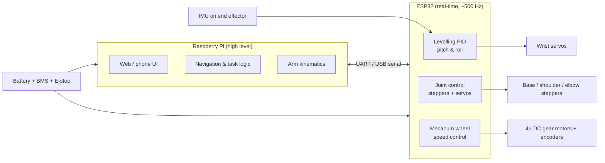

# PID-Robot-Waiter

A Raspberry Pi–controlled robot waiter for a mock restaurant: customers order from an app, the chef marks the order ready, and the robot follows a taped path to collect the plate and deliver it to the table. It has an omnidirectional mecanum base, a support mast,
and a 5-DOF robotic arm whose wrist uses IMU feedback and PID control to keep a plate level
while the robot moves.

> **Status:** planning / early build (Nov 2026 summer holidays)

## Concept

| Item | Target |
|---|---|
| Payload | One plate at a time, ≤ 1 kg |
| Serving height | ~800–900 mm (table height) |
| Drive | 4× mecanum wheels (holonomic) |
| Arm | 5 DOF: base yaw, shoulder, elbow, wrist pitch, wrist roll |
| End effector | Flat platform / fork that slides under the plate (not a claw) |
| Levelling | IMU on the end effector → PID on wrist pitch & roll |
| Brains | Raspberry Pi (high level) + ESP32 (real-time control) |

## System architecture



**Why two processors?** Linux on the Pi has timing jitter, which makes fast control loops wobbly.
The ESP32 runs every time-critical loop (IMU, PID, motors) at a fixed rate. The Pi sends
high-level commands ("drive at this velocity", "move arm to this pose") over serial.
See [`docs/serial-protocol.md`](docs/serial-protocol.md).

## Repository layout

```
docs/       Design notes, calculations, parts list, serial protocol
firmware/   ESP32 code (PlatformIO / Arduino): PID, IMU, motors, joints
pi/         Raspberry Pi Python code: navigation, kinematics, serial link
server/     Ordering app backend (FastAPI): customer page, chef dashboard, robot jobs
ml/         Plate / obstacle detection training (YOLO)
cad/        Mechanical CAD (arm links, gearboxes, mast, base)
hardware/   Wiring diagrams, schematics, power system
```

## Roadmap

1. **Mecanum base** *(in progress)*: drive smoothly with wheel speed PID, then line following with an IR array
2. **Tape-graph navigation:** NFC tags at nodes, route planning on the Pi, send the robot to "Table 3" from a terminal
3. **Ordering app:** FastAPI backend, customer QR-code ordering page, chef dashboard, and the "Ready" button dispatches the robot
4. **Arm + levelling:** geared-stepper arm, IMU wrist levelling PID, pickup from a fixed station
5. **Camera + ML:** YOLO plate detection at the pickup station (ArUco-assisted), obstacle/person detection
6. **Full demo:** a UQ study room set up as a mock restaurant

Full plan: [`docs/system-plan.md`](docs/system-plan.md)

## Docs

- [System plan: ordering app, navigation, ML](docs/system-plan.md)
- [Design notes & torque calculations](docs/design-notes.md)
- [Parts list](docs/parts-list.md)
- [Serial protocol (Pi ↔ ESP32)](docs/serial-protocol.md)

## Team

- Angad Singh ([@Pendu1699](https://github.com/Pendu1699))
- Aditya Lolam ([@adi2098](https://github.com/adi2098))

## License

MIT, see [LICENSE](LICENSE).
