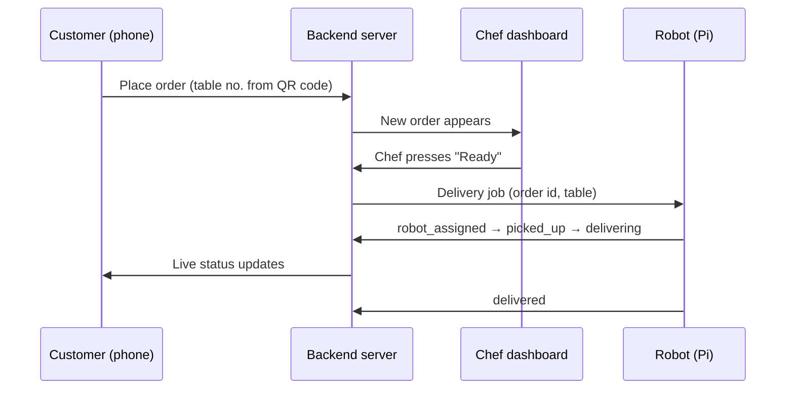

# System plan: ordering app, navigation and machine learning

## End goal

A customer orders from an app, the chef marks the order **Ready**, and the robot collects
the plate from the pickup station and delivers it to the customer's table.
Demo venue: a UQ study room set up as a mock restaurant.



## 1. Navigation: tape graph

**Line following:** black tape on the floor, with an IR reflectance sensor array (e.g. QTR-8RC)
under the front of the base, read by the ESP32. The line position gives an error signal for a
steering PID (line position → wheel speed difference).

**The tape layout is a graph:**

- **Nodes:** junctions, pickup station, each table, charging/home spot
- **Edges:** tape segments between nodes
- **Node identification:** an NFC/RFID sticker at each node (reader on the base), or ArUco
  markers seen by the camera. Counting junctions also works but drifts if one is missed.
- **Route planning (Pi):** BFS/Dijkstra over the graph, turned into a list of turns
  (e.g. `pickup → J1 (left) → J2 (straight) → T3`)
- **Mapping run:** the robot drives the whole network once and records which tag
  connects to which, building the graph automatically

**Venue notes:**

- Get permission before taping a UQ study room floor, and use removable gaffer/painter's tape
- UQ Wi-Fi (eduroam) usually blocks devices talking directly to each other. Use your own
  router or a phone hotspot for the server, robot and phones.

## 2. Ordering app (CRUD)

| Part | Choice |
|---|---|
| Backend | FastAPI (Python) + SQLite, running on a laptop |
| Customer page | Scan a QR code on the table (encodes table number), browse the menu, order |
| Chef dashboard | Live order list with a **Ready** button |
| Robot link | Pi connects to the backend over WebSocket (or MQTT) and receives delivery jobs |

**Order states:**

```
placed → cooking → ready → robot_assigned → picked_up → delivering → delivered
```

The robot reports every state change, so the customer page shows live status.

**Core data model (draft):**

| Table | Fields |
|---|---|
| `menu_items` | id, name, price, available |
| `tables` | id, name, graph_node |
| `orders` | id, table_id, status, created_at, updated_at |
| `order_items` | order_id, menu_item_id, qty |
| `robot_jobs` | id, order_id, status, started_at, finished_at |

## 3. Machine learning

Use ML only where a fixed rule can't do the job well. Line following and route planning
stay rule-based.

| Use | Approach | Priority |
|---|---|---|
| **Plate detection at pickup** | Fine-tune a small detector (YOLOv8n / YOLO11n) on a few hundred photos of our own plates at the station. Output: plate location → arm inverse kinematics → joint angles | Main ML feature |
| **Obstacle / person detection** | The same kind of detector. Stop or slow when someone crosses the path | Safety feature |
| Dish verification | Classify the plate and check it matches the order | Optional |

**Hardware:** Pi 5 + camera module. An AI accelerator HAT is optional, for faster inference.

**Make pickup easy for the robot:**

- Fixed pickup shelf at a known height
- ArUco marker beside the shelf gives the camera's exact position relative to the shelf
- YOLO then only has to find the plate within a small known area, which is much more
  reliable than searching the whole scene
- Drop-off: place the plate on the table edge at the table node. No ML needed.

**Dataset workflow:** take photos at the station under different lighting and plate positions,
label them (e.g. Roboflow / Label Studio), train in Colab, and export to ONNX/NCNN for the Pi.
Keep the dataset in a separate place, not in this repo (too large).
